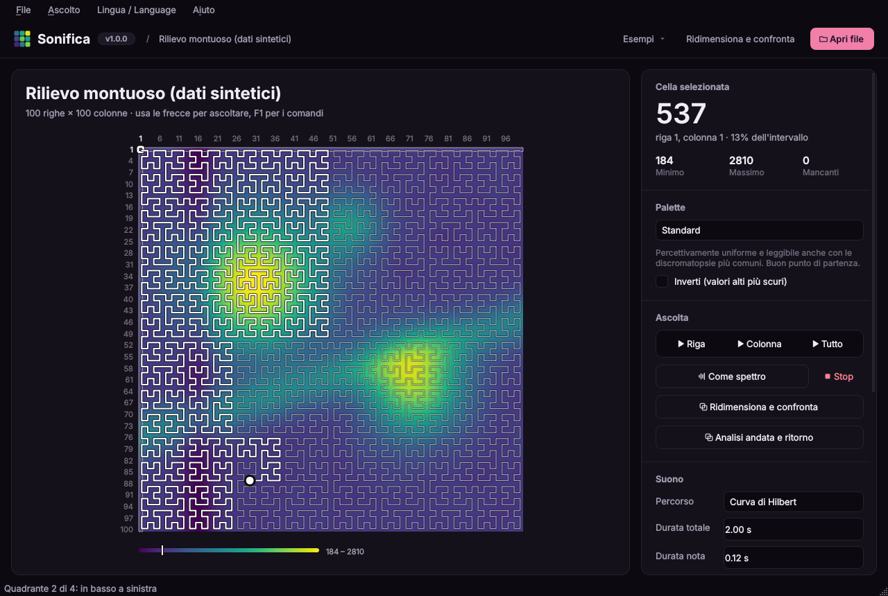

# Sonifica 🔊 · v1.0.0

**Explore heatmaps and data tables by ear.** · [Versione italiana](README.md)



Sonifica is a Python desktop app designed for blind and low-vision people, and useful to anyone who wants to *hear* data. Open a CSV file or a heatmap image and explore it cell by cell with the keyboard or the mouse. Every value becomes a sound:

| Data | Sound |
|---|---|
| high / low value | higher and louder / lower and softer note |
| column | stereo position, left to right |
| missing value | short hiss |
| edge of the table | low thud |

You can also play **the whole heatmap at once** as a single melodic line that follows a **Hilbert curve**: the duration is always the same, so similar matrices sound similar even with an extra row or a different resolution.

Other features:

- **palettes for different kinds of low vision**: colour blindness, glaucoma, cataract, macular degeneration, achromatopsia, photophobia;
- **six example heatmaps**, up to 120×160 cells, which you can **resize** like an image to check whether a visually similar but numerically different version still sounds the same;
- a **round-trip analysis**: data → audio → spectrogram → reconstructed data, to measure how much information survives;
- the interface is in **English and Italian**.

## Installation

Python 3.10 or newer. Download the project with `git clone` or *Code → Download ZIP* on GitHub.

### With conda (Anaconda / Miniconda)

```bash
git clone https://github.com/vbran-dev/sonifica.git
cd sonifica
conda create -n sonifica python=3.12 -y
conda activate sonifica
pip install .
```

### With Python and venv

```bash
git clone https://github.com/vbran-dev/sonifica.git
cd sonifica
python -m venv .venv
source .venv/bin/activate        # on Windows: .venv\Scripts\activate
pip install .
```

On Linux you also need PortAudio for sound (`sudo apt install libportaudio2`) and, for speech, speech-dispatcher (`sudo apt install speech-dispatcher`).

## Running

```bash
python -m sonifica                          # starts with example data
python -m sonifica examples/temperature.csv # opens a file
python -m sonifica --lang en                # English interface
python -m sonifica --version                # print the version
```

Installing also creates the short command `sonifica`. To develop: `pip install -e ".[dev]"`, then `pytest -q`.

## Keyboard

Everything works without a mouse. With the focus on the heatmap:

| Key | Action |
|---|---|
| Arrow keys | move one cell and hear the value |
| Home / End | start / end of the row |
| Page Up / Down | first / last row |
| Ctrl+Home / Ctrl+End | first / last cell |
| Space | play the whole row |
| C | play the whole column |
| Enter | read the current cell aloud |
| I | summary: size, minimum, maximum |
| Esc | stop the audio |

Anywhere: `Ctrl+O` open, `Ctrl+E` examples, `Ctrl+P` play the whole heatmap, `Ctrl+Shift+P` play as spectrum, `Ctrl+H` show the Hilbert path, `Ctrl+D` resize and compare, `Ctrl+R` round trip, `Ctrl+S` export WAV, `Ctrl+L` switch language, `F6` back to the heatmap, `F1` help.

Screen readers (NVDA, Orca, VoiceOver) read the current cell on every move. Qt's built-in text-to-speech is also available from the side panel.

## Language

English and Italian, from the **Lingua / Language** menu (labelled in both languages so it is always easy to find), from the side panel, or with `Ctrl+L`. The choice is saved with the other settings; on first launch the system language is used. Switching language also changes month and day names in the examples, the decimal separator and the speech voice when available.

## Example heatmaps

| Example | Size | Content |
|---|---|---|
| Monthly temperatures | 12×10 | months × years |
| Weekly traffic | 7×24 | days × hours, rush hours on weekdays |
| Correlation matrix | 10×10 | three groups of related variables |
| Sensors with missing data | 40×60 | smooth field with a failed block and scattered gaps |
| Mountain terrain | 100×100 | two peaks, a ridge, a valley |
| Wave interference | 120×160 | two wave sources, a fine regular pattern |

All are synthetic and reproducible. On large matrices row-by-row playback would take tens of minutes (100×100 ≈ 25 minutes), so the app suggests the Hilbert curve instead.

## Resize and compare

`Ctrl+D` shrinks the current heatmap like an image (**downscaling**) and compares it with the original: both heatmaps, the "listening tracks" (the value heard over time) for the Hilbert curve and for row-by-row playback, and their **coherence** (correlation between the tracks; 1 = they sound identical). Two methods: **area average** and **nearest sample**. You can play both versions and open the resized one.

| Heatmap | Resized to | Hilbert | Row by row |
|---|---|---|---|
| Terrain 100×100 | 50×50 | 0.99 | 0.27 |
| Terrain 100×100 | 25×25 | 0.98 | 0.31 |
| Terrain 100×100 | 10×10 | 0.93 | 0.31 |
| Sensors 40×60 | 20×30 | 0.99 | 0.24 |
| Waves 120×160 | 60×80 | 0.96 | 0.04 |
| Waves 120×160 | 24×32 | 0.71 | 0.03 |
| Temperatures 12×10 | 6×5 | 0.83 | 0.96 |

On large, image-like heatmaps the Hilbert curve stays coherent while row-by-row playback changes completely. With fine waves, coherence drops even for Hilbert once the waves become smaller than the cells, because the two images no longer look alike. On small tables organised by rows (each row a month), row-by-row playback can be more coherent: the Hilbert curve works best with spatial data.

## Why a Hilbert curve

Row-by-row playback depends on the shape of the table: one more row shifts every following note, and doubling the resolution makes the piece four times longer with a different rhythm. Sonifica maps the matrix onto the unit square and walks it along a Hilbert curve in a **fixed total time**. Two properties give coherence:

- **locality**: neighbouring cells are heard at nearby moments;
- **nesting**: the order-*n+1* curve refines the order-*n* curve without changing the visiting order, so a higher resolution adds detail instead of reshuffling the melody.

The path starts top left, goes down, crosses the bottom and ends top right. Three short clicks mark the passage between quadrants. `Ctrl+H` draws the path; during playback a dot shows where the sound is. Run `python examples/hilbert_coherence.py` to reproduce the comparison chart.

## Palettes for low vision

| Palette | Designed for |
|---|---|
| Standard (viridis) | general use |
| Red–green colour blindness (cividis) | protanopia, deuteranopia |
| Glaucoma, diabetic retinopathy, tritanopia | blue–yellow defects |
| Cataract | warm colours only, maximum contrast |
| Macular degeneration, low contrast | five distinct levels |
| Achromatopsia, greyscale | no colour perception, printing |
| Photophobia | albinism, aniridia: limited brightness |

Every palette has monotonically increasing lightness, tested also under simulated protanopia, deuteranopia and tritanopia (Machado et al., 2009). Missing values are hatched so they are not mistaken for low values.

> The palette–condition pairings follow general accessibility guidance and are **not clinically validated**. Everyone sees differently: the right palette is the one you read best.

## Versions

Sonifica follows [semantic versioning](https://semver.org/). The current version is **1.0.0**, the first public release; see [CHANGELOG.md](CHANGELOG.md). The version number lives only in `src/sonifica/__init__.py`.

## Use of artificial intelligence

Sonifica’s code was written with the support of an AI assistant. The idea, the design, the functional choices and the development of its features are by Valentina Brancati.

## License

MIT
