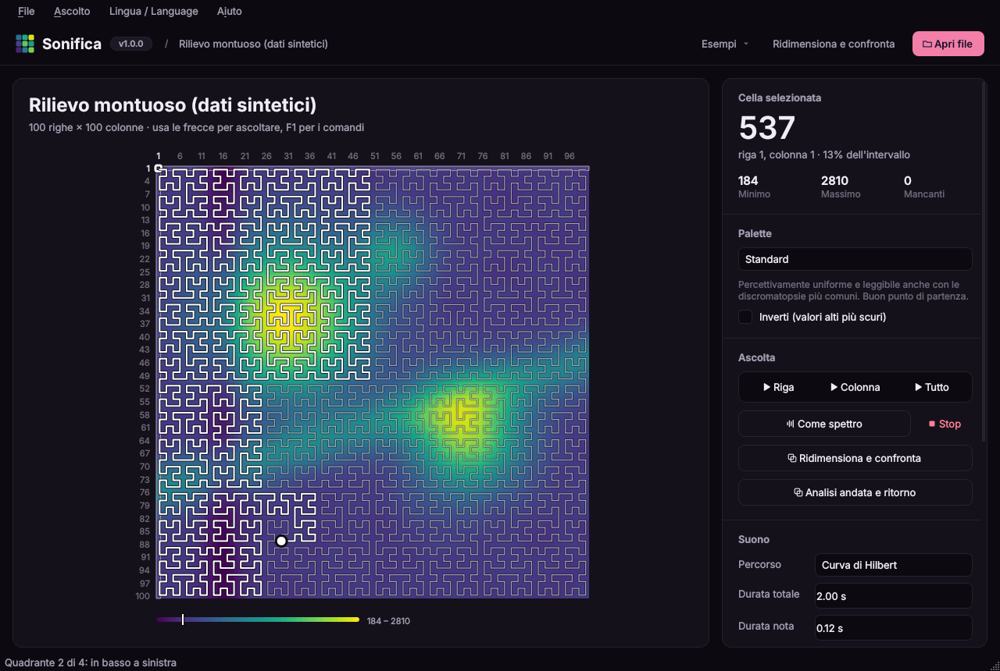
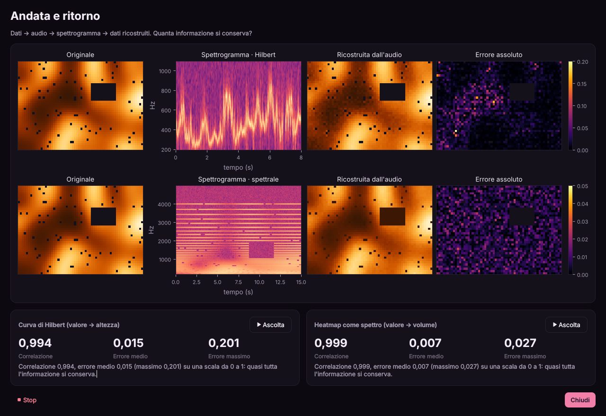
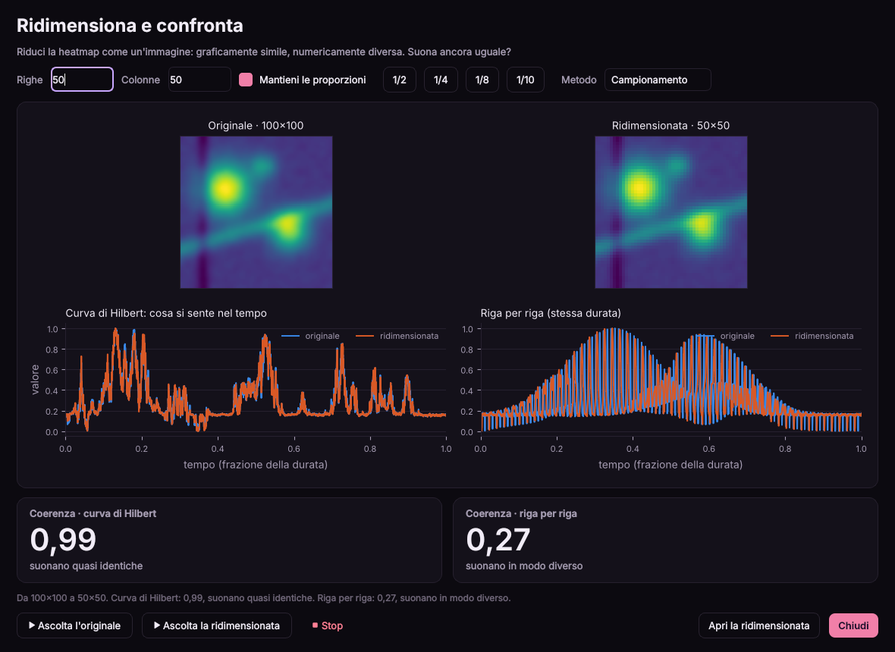
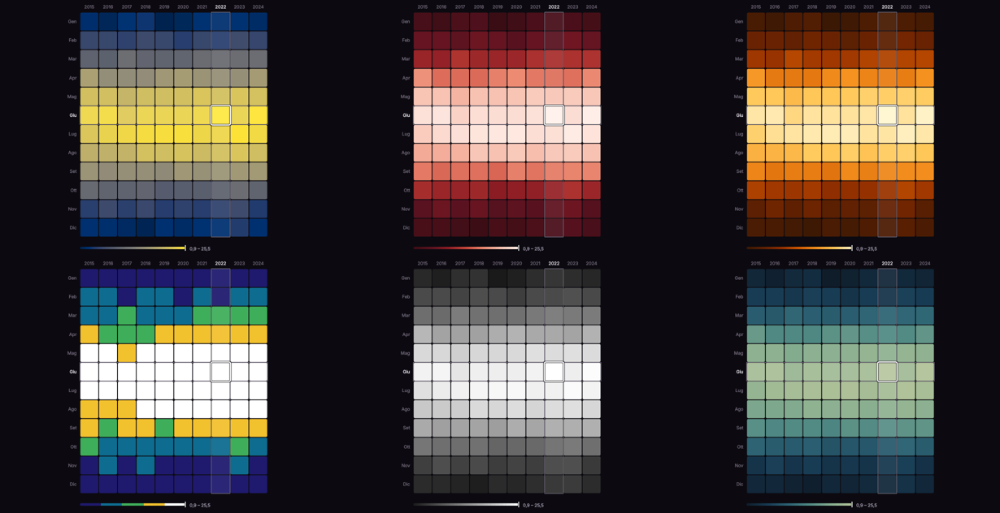
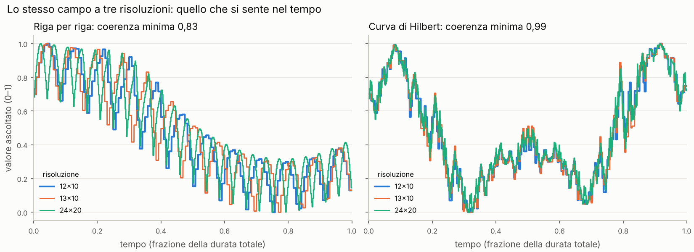

# Sonifica 🔊 · v1.0.0

**Esplora heatmap e tabelle di dati con l'udito.** · [English version](README.en.md)



Sonifica è un'applicazione desktop in Python pensata per persone non vedenti e ipovedenti, ma utile a chiunque voglia "sentire" i dati. Carichi un CSV o un'immagine di una heatmap e la esplori cella per cella con la tastiera o con il mouse. Ogni valore diventa un suono:

| Dato | Suono |
|---|---|
| valore alto / basso | nota più acuta e più forte / più grave e più debole |
| colonna | posizione stereo, da sinistra a destra |
| dato mancante | breve fruscio |
| bordo della tabella | colpo grave |

Si può ascoltare anche **tutta la heatmap in una volta**, come un'unica linea melodica che la percorre lungo una **curva di Hilbert**: la durata è sempre la stessa e matrici simili suonano in modo simile, anche se hanno una riga in più o una risoluzione diversa (vedi sotto).

La heatmap si può colorare con **palette pensate per diversi tipi di ipovisione**: daltonismo, glaucoma, cataratta, maculopatia, acromatopsia, fotofobia.

Puoi scegliere tra **sei heatmap di esempio**, fino a 120×160 celle, e **ridimensionarle** come un'immagine per verificare se una versione graficamente simile ma numericamente diversa suona ancora allo stesso modo.

L'interfaccia è in **italiano e in inglese**.

C'è anche un'**analisi di andata e ritorno**: i dati vengono trasformati in audio, l'audio viene analizzato con uno spettrogramma e da questo si ricostruiscono i dati. Confrontando originale e ricostruzione si misura quanta informazione sopravvive alla sonificazione, con tre codifiche diverse e con diversi livelli di rumore.



## Installazione

Serve Python 3.10 o superiore. Scarica il progetto con `git clone` oppure con *Code → Download ZIP* su GitHub, poi scegli una delle due strade.

### Con conda (Anaconda / Miniconda)

```bash
git clone https://github.com/vbran-dev/sonifica.git
cd sonifica
conda create -n sonifica python=3.12 -y
conda activate sonifica
pip install .
```

### Con Python e venv

```bash
git clone https://github.com/vbran-dev/sonifica.git
cd sonifica
python -m venv .venv
source .venv/bin/activate        # su Windows: .venv\Scripts\activate
pip install .
```

Su Linux servono anche PortAudio per l'audio (`sudo apt install libportaudio2`) e, per la lettura a voce, speech-dispatcher (`sudo apt install speech-dispatcher`).

## Avvio

Con l'ambiente attivo:

```bash
python -m sonifica                          # parte con i dati di esempio
python -m sonifica examples/temperature.csv # apre direttamente un file
python -m sonifica --lang en                # interfaccia in inglese
python -m sonifica --version                # mostra la versione
```

L'installazione crea anche il comando breve `sonifica`, equivalente a `python -m sonifica`.

Le volte successive basta riattivare l'ambiente (`conda activate sonifica` oppure `source .venv/bin/activate`) e lanciare di nuovo il comando.

### Per chi vuole modificare il codice

Installa in modalità sviluppo, così le modifiche ai file in `src/` hanno effetto subito senza reinstallare, e ottieni anche gli strumenti per i test:

```bash
pip install -e ".[dev]"
pytest -q
```

## Comandi da tastiera

Tutto si può fare senza mouse. Con il focus sulla heatmap:

| Tasto | Azione |
|---|---|
| Frecce | spostati di una cella e senti il valore |
| Home / Fine | inizio / fine della riga |
| Pagina su / giù | prima / ultima riga |
| Ctrl+Home / Ctrl+Fine | prima / ultima cella |
| Spazio | ascolta la riga intera |
| C | ascolta la colonna intera |
| Invio | leggi a voce la cella corrente |
| I | riepilogo: dimensioni, minimo, massimo |
| Esc | ferma l'audio |

Comandi globali: `Ctrl+O` apri, `Ctrl+E` esempi, `Ctrl+P` ascolta tutta la heatmap, `Ctrl+Maiusc+P` ascolta come spettro, `Ctrl+H` mostra il percorso di Hilbert, `Ctrl+D` ridimensiona e confronta, `Ctrl+R` analisi, `Ctrl+S` esporta WAV, `Ctrl+L` cambia lingua, `F6` torna alla heatmap, `F1` guida.

La cella corrente viene esposta come nome accessibile del widget, quindi gli screen reader (NVDA, Orca, VoiceOver) la leggono a ogni spostamento. In alternativa c'è la sintesi vocale integrata di Qt, attivabile dal pannello laterale.

## Formati supportati

- **CSV / TSV**: separatore `,` `;` tab o `|`, rilevato in automatico. I decimali possono avere la virgola (`3,14`). La prima riga e la prima colonna vengono riconosciute come etichette quando contengono testo o anni. Le celle vuote o `NA` sono dati mancanti.
- **Immagini** (PNG, JPG, …): convertite in luminosità e ridotte a massimo 128×128 celle. Con colormap a luminosità crescente (viridis, magma, scala di grigi) la luminosità segue fedelmente il valore originale.

## Heatmap di esempio

Dal pulsante **Esempi** (`Ctrl+E`). Sono tutte sintetiche e riproducibili:

| Esempio | Dimensioni | Cosa contiene |
|---|---|---|
| Temperature mensili | 12×10 | mesi × anni, stagionalità e un leggero trend |
| Traffico settimanale | 7×24 | giorni × ore, con le ore di punta nei giorni feriali |
| Matrice di correlazione | 10×10 | tre gruppi di variabili legate, valori da −1 a 1 |
| Sensori con dati mancanti | 40×60 | campo continuo con un blocco guasto e letture sparse mancanti |
| Rilievo montuoso | 100×100 | due cime, una cresta, una valle |
| Interferenza di onde | 120×160 | due sorgenti d'onda, un disegno fitto e regolare |

Con le matrici grandi la lettura riga per riga durerebbe decine di minuti (100×100 ≈ 25 minuti), quindi l'app la blocca e propone la curva di Hilbert, che dura sempre uguale. Per lo stesso motivo l'analisi di andata e ritorno salta la sequenza di note oltre le 1200 celle.

## Ridimensiona e confronta

`Ctrl+D` apre una finestra che riduce la heatmap corrente come si fa con un'immagine (**downscaling**) e confronta originale e versione ridotta:



- scegli righe e colonne, oppure un fattore (1/2, 1/4, 1/8, 1/10), con o senza proporzioni bloccate;
- due metodi: **media dell'area** (ogni nuova cella è la media delle celle che copre, come nel ridimensionamento di una foto) e **campionamento** (ogni nuova cella prende il valore della cella al suo centro);
- in alto le due heatmap, sotto le due "tracce di ascolto" (il valore che si sente nel tempo) per la curva di Hilbert e per la lettura riga per riga;
- la **coerenza** è la correlazione tra le due tracce: 1 significa che suonano identiche;
- puoi ascoltare originale e ridotta una dopo l'altra, e aprire la ridotta nella finestra principale.

Alcuni risultati con la media dell'area:

| Heatmap | Riduzione | Hilbert | Riga per riga |
|---|---|---|---|
| Rilievo 100×100 | 50×50 | 0,99 | 0,27 |
| Rilievo 100×100 | 25×25 | 0,98 | 0,31 |
| Rilievo 100×100 | 10×10 | 0,93 | 0,31 |
| Sensori 40×60 | 20×30 | 0,99 | 0,24 |
| Onde 120×160 | 60×80 | 0,96 | 0,04 |
| Onde 120×160 | 24×32 | 0,71 | 0,03 |
| Temperature 12×10 | 6×5 | 0,83 | 0,96 |

Come leggerli:

- sulle heatmap grandi e "grafiche", ridotte mantenendo l'aspetto, la curva di Hilbert resta coerente mentre la lettura riga per riga cambia completamente;
- con le **onde fitte** la coerenza cala anche con Hilbert quando le onde diventano più piccole delle celle: le due immagini non si somigliano più, ed è giusto che non si somiglino nemmeno a orecchio;
- sulle **tabelline piccole organizzate per righe** (le temperature: ogni riga è un mese) la lettura per righe può essere più coerente. Hilbert dà il meglio con dati spaziali, non con tabelle in cui righe e colonne hanno significati diversi.

## Palette per l'ipovisione

Dal pannello laterale si sceglie la palette più leggibile per la propria condizione. "Inverti" scambia chiari e scuri.



| Palette | Pensata per | Idea |
|---|---|---|
| Standard (viridis) | uso generale | percettivamente uniforme, leggibile con le discromatopsie comuni |
| Daltonismo rosso–verde (cividis) | protanopia, deuteranopia | usa solo l'asse blu–giallo |
| Glaucoma, retinopatia diabetica, tritanopia | difetti blu–giallo, spesso acquisiti | dal rosso scuro al bianco, niente blu–giallo |
| Cataratta | cristallino opacizzato | solo colori caldi (il blu viene filtrato), massimo contrasto |
| Maculopatia, bassa sensibilità al contrasto | visione centrale ridotta | 5 livelli netti con grandi salti di luminosità |
| Acromatopsia, scala di grigi | assenza di visione dei colori, stampa | solo luminosità |
| Fotofobia | albinismo, aniridia | luminosità massima contenuta, toni tenui |

Tutte le palette hanno una luminosità che cresce in modo monotono, e i test lo verificano anche **simulando protanopia, deuteranopia e tritanopia** (matrici di Machado et al., 2009). Il valore minimo resta sempre distinguibile dallo sfondo scuro, e i dati mancanti sono tratteggiati, così non si confondono con un valore basso.

> Le associazioni tra palette e condizione seguono indicazioni generali di accessibilità e **non sono validate clinicamente**. Ogni persona vede in modo diverso: la palette giusta è quella che si legge meglio.

## Ascoltare tutta la heatmap: la curva di Hilbert

Leggere la matrice riga per riga, una nota per cella, ha un difetto: il suono dipende dalla forma della tabella. Una riga in più allunga il brano e sposta tutte le note successive; una risoluzione doppia lo rende quattro volte più lungo e con un ritmo completamente diverso. Due matrici quasi uguali suonano come due brani diversi.

Sonifica invece stende la matrice sul quadrato unitario e la percorre lungo una **curva di Hilbert**, con una **durata totale fissa** (8 secondi di default). Ogni istante del suono corrisponde a un punto del quadrato, indipendentemente da quante righe e colonne ci sono. Due proprietà della curva danno la coerenza:

- **località**: celle vicine nella matrice vengono ascoltate in momenti vicini, quindi una modifica locale cambia solo un breve tratto del suono;
- **annidamento**: la curva di ordine *n+1* raffina quella di ordine *n* senza cambiarne l'ordine di visita, quindi una risoluzione maggiore aggiunge dettaglio invece di stravolgere la melodia.

Il percorso parte in alto a sinistra, scende, attraversa il basso e finisce in alto a destra. Tre tocchi secchi segnano il passaggio tra i quattro quadranti, per orientarsi anche senza vedere. Con `Ctrl+H` il percorso si disegna sulla heatmap, e durante l'ascolto un punto mostra dove si trova il suono.



Lo stesso campo campionato a risoluzioni diverse, confrontato con la versione 12×10 (correlazione tra ciò che si ascolta nel tempo; 1 = identico). Anche per le righe la durata è normalizzata, per un confronto equo:

| Confronto con 12×10 | Righe | Hilbert |
|---|---|---|
| 13×10 (una riga in più) | 0,83 | 0,99 |
| 24×20 (risoluzione doppia) | 0,87 | 0,99 |
| 36×30 | 0,85 | 0,99 |
| 40×40 | 0,84 | 0,99 |
| 12×11 (una colonna in più) | 1,00 | 0,99 |

Per riprodurre la tabella e il grafico: `python examples/hilbert_coherence.py`. Quando cambia solo il numero di colonne, la lettura per righe (normalizzata nel tempo) regge altrettanto bene; il vantaggio di Hilbert sta nei cambi di righe e di risoluzione. La lettura riga per riga resta comunque disponibile nelle impostazioni.

Il prezzo della durata fissa: con matrici molto grandi ogni cella dura pochissimo, quindi si sente la forma generale e non il singolo valore. Per i dettagli si naviga cella per cella.

## Come funziona

```
src/sonifica/
├── data.py        caricamento di CSV e immagini, ridimensionamento
├── examples.py    le heatmap di esempio
├── i18n.py        traduzioni italiano / inglese
├── mapping.py     mappatura dato → frequenza, volume, panning (anche su scale musicali)
├── hilbert.py     curva di Hilbert: percorso, campionamento, coerenza
├── palettes.py    palette per l'ipovisione e simulazione delle discromatopsie
├── synth.py       sintesi: toni, sequenze, percorso di Hilbert, heatmap come spettro
├── analysis.py    spettrogramma, ricostruzione, metriche, rumore
├── audio.py       riproduzione (sounddevice) ed esportazione WAV
└── ui/            interfaccia PySide6 (tema in ui/theme.py, icone in ui/icons.py)
```

Il nucleo (`data`, `examples`, `mapping`, `hilbert`, `palettes`, `synth`, `analysis`) non dipende dalla UI, quindi si può usare anche da script o da notebook:

```python
from sonifica.data import resample
from sonifica.examples import build
from sonifica.hilbert import coherence

terrain = build("terrain")                # 100×100
small = resample(terrain, 25, 25)         # media dell'area
print(coherence(terrain.normalized(), small.normalized(), "hilbert"))  # ≈ 0.98
print(coherence(terrain.normalized(), small.normalized(), "righe"))    # ≈ 0.31
```

## Lingua

Italiano e inglese, dal menu **Lingua / Language** (scritto in entrambe le lingue, così si ritrova sempre), dal pannello laterale o con `Ctrl+L`. La scelta resta salvata insieme alle altre impostazioni. Al primo avvio si usa la lingua del sistema. Cambiando lingua cambiano anche i nomi dei mesi e dei giorni negli esempi, il separatore decimale (`3,5` / `3.5`) e la voce della sintesi vocale, se disponibile.

Le traduzioni sono in `src/sonifica/i18n.py`. Un test controlla che ogni testo esista in entrambe le lingue con gli stessi segnaposto.

### Le tre codifiche

1. **Curva di Hilbert**: un'unica linea melodica a durata fissa; il valore è l'altezza. La ricostruzione filtra la banda usata, ricava la frequenza istantanea dal segnale analitico e ne prende la mediana per ogni vertice della curva.
2. **Sequenza di note**: ogni cella è una nota e il valore è codificato nell'altezza, su scala logaritmica come la percepisce l'orecchio. La ricostruzione stima la frequenza del picco di ogni nota.
3. **Heatmap come spettro**: ogni riga è una sinusoide a frequenza fissa, ogni colonna un istante di tempo, il valore è l'ampiezza. Si sente un'intera colonna in un solo accordo.

I primi risultati: senza rumore tutte e tre si ricostruiscono quasi alla perfezione. Con il rumore, la codifica in altezza resta stabile mentre quella in volume si degrada. Quantizzare su una scala musicale (pentatonica) rende il suono più gradevole, ma introduce un errore misurabile.

## Test

```bash
pytest -q
ruff check src tests examples
```

La CI su GitHub Actions esegue test e lint a ogni push.

## Creare un eseguibile

Per distribuire l'app a chi non ha Python:

```bash
pip install pyinstaller
pyinstaller --name Sonifica --windowed --collect-all sonifica src/sonifica/__main__.py
```

L'eseguibile si trova in `dist/Sonifica/`.

## Idee per sviluppi futuri

- Test con utenti non vedenti per validare le mappature (la parte più importante per una tesi)
- Toni di riferimento per minimo e massimo, per orientarsi nella scala
- Navigazione per "salti": vai al prossimo massimo locale, al prossimo dato mancante
- Supporto a file Excel e JSON
- Ridimensionamento con altri filtri (gaussiano, mediana) e confronto con il rumore
- Modalità "contorno": suona solo dove il valore supera una soglia
- Percezione umana nell'analisi: quanti livelli distinti si riescono davvero a distinguere a orecchio

## Versioni

Sonifica segue il [versionamento semantico](https://semver.org/lang/it/) (MAGGIORE.MINORE.CORREZIONE). La versione attuale è la **1.0.0**, la prima pubblica. Si vede accanto al nome nell'app, nella barra del titolo e in *Aiuto → Informazioni su Sonifica*. Le novità di ogni versione sono in [CHANGELOG.md](CHANGELOG.md).

Per pubblicare una nuova versione basta cambiare il numero in `src/sonifica/__init__.py` (è l'unico punto) e aggiungere la voce nel changelog: un test controlla che i due siano allineati.

## Uso dell’intelligenza artificiale

La stesura del codice di Sonifica è avvenuta anche grazie al supporto di un assistente di intelligenza artificiale. L’idea, la progettazione, le scelte di funzionamento e lo sviluppo delle diverse funzionalità sono a cura di Valentina Brancati.

## Licenza

MIT
